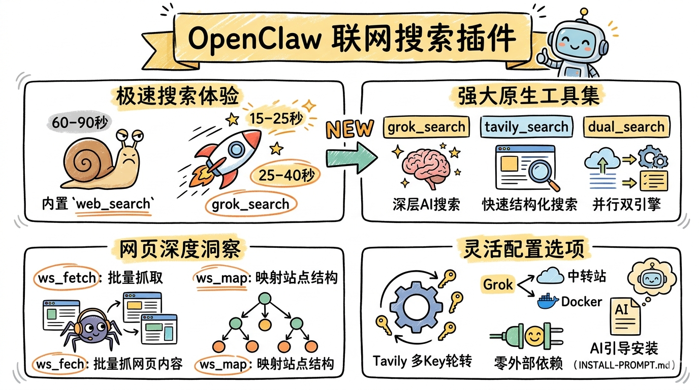

# OpenClaw Web Search Plugin

A plugin that provides web search capabilities to OpenClaw. Send messages to the Agent via Feishu / Telegram / WeCom to trigger searches, scrape web pages, and map site structures.



> **Recommended Installation Method:** Send the content of [INSTALL-PROMPT.md](INSTALL-PROMPT.md) to **Claude Code (CC)**. The AI will guide you step-by-step through the entire configuration process without requiring manual intervention.

> **Acknowledgments:** The search prompts and tool design of this project are inspired by [UltimateSearchSkill](https://github.com/ckckck/UltimateSearchSkill.git). Thanks to the original author for their open-source contribution.

---

## Why This Plugin?

Before installing the plugin, the OpenClaw Agent only had two ways to search the web:

- **Built-in `web_search` (group:web)** — Slow, triggers a reasoning chain, taking 60-90 seconds even for simple questions.
- **Browser Tool (group:ui)** — Even slower, uses Chromium to scrape pages, and is prone to timeouts and disconnections.

After installing this plugin, the Agent gains a **dedicated search tool**, making its behavior more restrained and precise. Real-world speed comparison:

| Scenario | Time |
|:-----|:-----|
| Normal conversation (no search) | 5-10 sec |
| Search queries (tavily_search) | 15-25 sec |
| Deep search (grok_search) | 25-40 sec |
| Before fix (built-in web_search + reasoning) | 60-90 sec |

**Tip:** It works best when combined with `reasoning: false`. Otherwise, the model will "think" for a long time before calling the tool, negating the speed advantage.

---

## Skill vs Tool: Why Refactor?

In OpenClaw, Skills and Tools are two different extension mechanisms:

**Skill:** A `SKILL.md` file that instructs the Agent on how to call external Shell scripts (.sh) via Bash. Requires system commands like `bash`, `curl`, `jq`, etc. Input and output are plain text, so the Agent has to parse them itself.

**Plugin Tool:** Registered as a native tool via `api.registerTool()`, appearing directly in the Agent's tool list. The Agent calls it by name (e.g., `grok_search`), parameters are validated against a JSON Schema, and results are structured data.

[UltimateSearchSkill](https://github.com/ckckck/UltimateSearchSkill.git) uses the Skill approach: 5 Shell scripts + `SKILL.md` instructions + 3 Docker containers (`grok2api` + `FlareSolverr` + `TavilyProxyManager`).

This project refactors it into a **Plugin Tool**, retaining all 5 tool functionalities, with specific improvements:

- **Skill → Plugin Tool** — Replaced Shell scripts with native `api.registerTool()` tools, allowing direct Agent calls with more reliable parameter validation and error handling.
- **Removed TavilyProxyManager container** — The original used a separate Docker container for multi-key Tavily proxying; this project builds the rotation logic directly into the plugin code (automatically switches to the next key upon encountering 429/401 errors).
- **Supports Grok Relays** — The original could only access Grok via a local `grok2api` Docker setup; this project additionally supports any OpenAI-compatible relay, requiring no Docker when using a relay.
- **Zero External Dependencies** — No `npm install`, no compilation, no `curl`/`jq` required. OpenClaw directly loads the TypeScript files after copying.
- **AI-Guided Installation** — Provides `INSTALL-PROMPT.md` for setup guidance. Send it to Claude Code to automatically complete the installation and configuration.

---

## Tool Overview

| Tool | Purpose | Features |
|:-----|:-----|:-----|
| `tavily_search` | Fast structured search | Returns clean summaries, no HTML parsing needed, fast |
| `grok_search` | AI deep search | Reasoning-enabled search, ideal for complex questions, returns analyzed results with citations |
| `dual_search` | Dual-engine parallel search | Calls Grok + Tavily simultaneously, merges results |
| `ws_fetch` | Web page content scraping | Lighter than a browser, extracts raw content directly, supports batch multi-URL |
| `ws_map` | Site structure exploration | Discovers site URL structures, provides a complete site overview |
| `exa_search` | Semantic search + deep research | Supports neural/fast/deep modes, category filtering (news/github/research papers, etc.), returns highlights / full text / AI summaries |

---

## Quick Installation

### Prerequisites

- OpenClaw is running (Node.js >= 22)
- At least one messaging channel available (Feishu / Telegram / WeCom)

### 1. Deploy Plugin

```bash
mkdir -p ~/.openclaw/extensions/oc-websearch
cp -r <plugin-source-path>/* ~/.openclaw/extensions/oc-websearch/
```

### 2. Configure API Keys

Edit `~/.openclaw/extensions/oc-websearch/web-search.env`:

```env
# --- Required ---

# Tavily (comma-separated multiple keys, 1000 free queries/month)
# Apply: https://tavily.com
TAVILY_API_KEY=tvly-key-1,tvly-key-2

# Grok (Recommended relay: https://ai.huan666.de, daily check-in gives balance, fast speed)
GROK_API_URL=https://ai.huan666.de
GROK_API_KEY=sk-your-key
GROK_MODEL=grok-4.1-fast

# --- Optional ---

# FireCrawl (fallback scraper for ws_fetch)
# Apply: https://firecrawl.dev
# FIRECRAWL_API_KEY=fc-your-key
```

### 3. Enable Plugin

Add the following to `~/.openclaw/openclaw.json`:

```jsonc
{
  "plugins": {
    "allow": ["oc-websearch"],
    "entries": {
      "oc-websearch": { "enabled": true }
    }
  },
  "tools": {
    "alsoAllow": ["group:plugins"]
  }
}
```

### 4. Restart to Apply

```bash
openclaw gateway stop && openclaw gateway start
```

You will see the following log upon successful installation:

```
[plugins] oc-websearch: All 5 tools registered successfully
```

---

## Grok Backend: Two Options

### Option A: Relay (Recommended)

Simply fill in the relay address and key. Zero maintenance required.

```env
GROK_API_URL=https://your-relay.com
GROK_API_KEY=sk-xxx
GROK_MODEL=grok-4.1-fast
```

### Option B: Local grok2api Docker (Free)

Suitable for users who prefer free options and don't mind some setup.

```bash
cd ~/web-search-docker
cp <plugin-source-path>/docker/docker-compose.yml .
docker compose up -d
```

After starting, you need to:

1. Visit `http://127.0.0.1:8000/admin` to access the admin panel
2. Obtain the Grok SSO Cookie:
   - Log in to [grok.com](https://grok.com) in your browser
   - Press F12 to open DevTools → Application → Cookies → `https://grok.com`
   - Copy the cookie value named `sso` or `sso-rw` (a JWT string starting with `eyJ`)
3. Add the SSO Cookie to the **ssoBasic** pool in the admin panel (Note: It must be added to `ssoBasic`, not `default`, otherwise the API won't find the token)
4. Configure the proxy and FlareSolverr addresses in `data/grok2api/config.toml`

```env
GROK_API_URL=http://127.0.0.1:8000
GROK_API_KEY=your-admin-password
GROK_MODEL=grok-3-mini
```

**Comparison:**

| | Relay | Local Docker |
|:--|:-------|:-----------|
| Cost | ~$0.001/query | Free |
| Model | grok-4.1-fast & full series | grok-3-mini |
| Stability | High | Depends on CF bypass, occasionally fails |
| Maintenance | None | Docker + Token + CF rotation |

---

## Design Details

**Configuration Priority**

```
web-search.env > openclaw.json pluginConfig > Code defaults
```

**Tavily Multi-Key Rotation** — Uses a sticky strategy: stick with the current key until a 429 (limit exhausted) or 401 (invalid) error occurs, then automatically switch to the next one. Multiple free keys can stack their quotas.

**ws_fetch Fallback Chain** — `Tavily Extract (batch, preferred) → FireCrawl Scrape (per-URL, fallback) → Error`. If FireCrawl Key is not configured, only the first level is available.

---

## Usage Recommendations

- **Combine with `reasoning: false`** — It's recommended to disable reasoning in the Agent configuration. Otherwise, the model will "think" for a long time before calling the search tool, negating the speed advantage.
- **grok_search Quality Depends on Relay** — If using a third-party relay, search quality and stability depend on the relay's service level.
- **SOUL.md Integration** — It's recommended to add a prompt in the Agent's `SOUL.md` like "do not overuse search", instructing the model to only call search tools when truly necessary.

---

## Porting to Another Machine

1. Copy the plugin directory
2. Place it in `~/.openclaw/extensions/oc-websearch/` on the target machine
3. Edit `web-search.env` to input API Keys
4. Add `allow` and `alsoAllow` entries in `openclaw.json`
5. Restart the Gateway

No `npm install` or external dependencies required.

---

## Troubleshooting

| Symptom | Cause | Solution |
|:-----|:-----|:-----|
| Plugin not loaded | `plugins.allow` missing `oc-websearch` | Add to the allow array |
| Agent doesn't call search tools | Tools not exposed to Agent | Add `group:plugins` to `tools.alsoAllow` |
| Grok errors | Relay: Insufficient balance or incorrect Key | Check balance and Key |
| Grok errors | Docker: Token not in ssoBasic pool | Re-add to ssoBasic |
| Grok errors | Docker: CF expired (403) | Restart container to trigger refresh |
| Tavily 401/429 | Invalid key or quota exhausted | Auto-rotates; add a new key if all are exhausted |
| Feishu/WeCom reply interruption | LLM API rate limiting | Wait for the rate limit window to pass and retry |

---

## File Structure

```
oc-websearch/
├── index.ts                  # Entry point, registers 5 tools
├── openclaw.plugin.json      # Plugin manifest
├── package.json
├── web-search.env            # API Keys (do not commit to Git)
├── sync.sh                   # Dev utility: sync to WSL and restart
├── src/
│   ├── config.ts             # Configuration parsing
│   ├── tavily-key-pool.ts    # Tavily Key rotation
│   ├── utils.ts              # HTTP wrapper
│   └── tools/
│       ├── grok-search.ts
│       ├── tavily-search.ts
│       ├── web-fetch.ts
│       ├── web-map.ts
│       └── dual-search.ts
└── docker/
    └── docker-compose.yml    # grok2api local deployment (optional)
```
